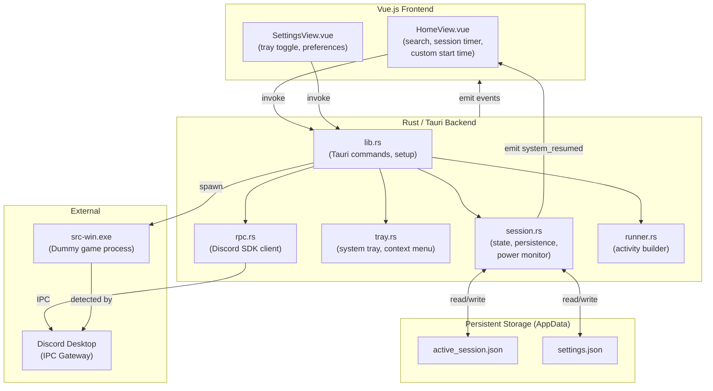

# Discord Quest Completer — Custom Build

> Originally a fork of [markterence/discord-quest-completer](https://github.com/markterence/discord-quest-completer)
>
> This project started as a fork of Mark Terence Tiglao's Discord Quest Completer. I extended and customized the original application with additional desktop functionality, session persistence, timer management, and Discord Rich Presence customization.

---

## Table of Contents

- [About This Project](#about-this-project)
- [What Was Added vs Original](#what-was-added-vs-original)
- [Why I Customized This Project](#why-i-customized-this-project)
- [Features](#features)
  - [Original Features](#original-features)
  - [Custom Features Added](#custom-features-added)
- [Technology Stack](#technology-stack)
- [Architecture](#architecture)
- [Screenshots](#screenshots)
- [Installation and Development Setup](#installation-and-development-setup)
- [Development Challenges and Lessons Learned](#development-challenges-and-lessons-learned)
- [Testing](#testing)
- [Project Structure](#project-structure)
- [Known Limitations and Disclaimer](#known-limitations-and-disclaimer)
- [Credits and License](#credits-and-license)

---

## About This Project

**Discord Quest Completer** is a Windows desktop application that simulates verified game processes so Discord can detect them, allowing you to complete Discord Quests without downloading massive game files.

The original application was created by [Mark Terence Tiglao](https://github.com/markterence). It spawns minimal Win32 dummy executables that mimic game process names Discord looks for during its "Registered Games" detection. This satisfies Discord's Quest requirements without installing the actual game.

**This is an independently maintained customized build** running on branch `my-custom-build`. It preserves the full original functionality and adds four significant features on top of it:

1. **System Tray Integration** — minimize to tray, background operation
2. **Persistent Game Sessions** — survive sleep, hibernation, and application restarts
3. **Windows Power Event Handling** — auto-resync after wake
4. **Custom Start Time** — set arbitrary Discord Rich Presence elapsed time

---

## What Was Added vs Original

| Capability | Original | This Build |
|---|---|---|
| Dummy game process spawning | ✅ | ✅ |
| Discord Rich Presence (experimental) | ✅ | ✅ |
| Fuzzy game search | ✅ | ✅ |
| System tray minimize | ❌ | ✅ |
| Persistent minimize-to-tray preference | ❌ | ✅ |
| Session timer survives hibernation | ❌ | ✅ |
| Session recovery after app restart | ❌ | ✅ |
| Power event (sleep/wake) detection | ❌ | ✅ |
| Custom RPC elapsed time input | ❌ | ✅ |
| Automated Rust integration tests | ❌ | ✅ (7 tests) |

---

## Why I Customized This Project

### A. No System Tray Support

The original application didn't support minimizing to the system tray. When I closed or minimized the window, I lost visibility of active sessions. I wanted the application to remain running silently in the background while Discord Quests progressed, without occupying a taskbar slot or requiring the window to stay open.

### B. Timer Reset After Hibernation

The original elapsed timer relied on the application's process uptime. This is fundamentally different from wall-clock time:

- **Process uptime** pauses when the CPU stops executing — this includes during Windows sleep and hibernation.
- **Wall-clock time** (Unix timestamps) continues advancing regardless.

If I started a 15-minute Quest, closed the laptop lid for 20 minutes, then opened it — the timer would resume from where it paused, not from the actual elapsed 35 minutes. The Discord RPC start timestamp could also drift or reset on reconnect.

I wanted a timer that honestly reflects elapsed real-world time: *2 hours before hibernation + 30 minutes hibernated = 2 hours 30 minutes after resume.*

### C. No Persistent Session Recovery

If the application crashed or I restarted it mid-Quest, all session information was lost. I had to start over with no way to know how much time had already elapsed. I wanted session information — specifically the original Unix start timestamp — to survive application restarts.

### D. Limited RPC Timer Customization

The experimental Discord Rich Presence feature always showed elapsed time from when the RPC connection was first established. I wanted a way to manually set an arbitrary elapsed duration for display in Discord. For example: showing "3 hours elapsed" on a game where I had been playing elsewhere and wanted the status to reflect the actual session, not just when I launched the app.

---

## Features

### Original Features

These features were implemented by [Mark Terence Tiglao](https://github.com/markterence) in the original repository and are preserved unchanged in this build.

- **Detectable Game Catalog**: Fetches verified detectable games from GitHub mirror, with fallback to Discord's official API and a bundled static JSON snapshot. Over 1,000 Discord-verified applications are supported.
- **Fuzzy Search Engine**: Powered by [Fuse.js](https://github.com/krisk/Fuse) with weighted indexing across game titles, known aliases, and registered executable paths.
- **Multi-Executable Path Resolving**: Handles complex nested executable paths (e.g., `Binaries/Win64/Game.exe`) and displays platform badges.
- **Zero-Installation Dummy Game Runner**: Provisions folder structures matching Discord's detection criteria and generates minimal Win32 executable stubs without requiring .NET or any game installation.
- **Discord Rich Presence (Experimental)**: Direct connection to Discord's local IPC Gateway using the `discord-sdk` crate. Sends activity updates for the selected game using its App ID.

### Custom Features Added

These features were implemented by me in this independent customized build.

#### 🗂️ System Tray Integration

Keeps the application alive in the Windows notification area while freeing your taskbar.

- Native system tray icon using Tauri v2's `TrayIconBuilder`
- Context menu with three actions:
  - **Open Application** — restores and focuses the window
  - **Hide Application** — hides the window to the tray
  - **Exit Application** — cleanly terminates via `app.exit(0)`
- Left double-click on the tray icon instantly restores the window
- When enabled, the window close button hides instead of exits (`CloseRequested` → `window.hide()` + `api.prevent_close()`)
- Persistent user preference: `Minimize to Tray on Close` stored in `settings.json`
- Background processes, session timers, and Discord Rich Presence continue operating normally while the window is hidden
- Toggle available from the **Settings** page

#### 💾 Persistent Game Sessions

Session information survives sleep, hibernation, application crashes, and restarts.

- Session state serialized to `active_session.json` in the application data directory
- Stored fields: `session_id`, `app_id`, `game_name`, `executable_name`, `start_timestamp`, `is_active`, `last_sync_timestamp`
- Elapsed time calculated as: `elapsed = current_unix_timestamp − session_start_timestamp`
- Hibernate time counts towards elapsed time:
  > **Example:** 2 hours playing → hibernate 30 minutes → resume → app shows **2 hours 30 minutes elapsed**
- On application launch, any active session is automatically restored and the timer resumes from the correct position
- Discord Rich Presence reuses the original `start_timestamp` on reconnect, so the Discord-displayed elapsed time matches reality
- Live `HH:MM:SS` elapsed timer displayed in the main UI while a Quest session is running

#### ⚡ Windows Power Event Handling

Automatic detection and recovery when the computer wakes from sleep or hibernation.

- Background Rust monitor watches for wall-clock discontinuities greater than 3 seconds between ticks
- On wake detection:
  - Re-evaluates elapsed time immediately using the persisted `start_timestamp`
  - Emits a `system_resumed` event to the Vue frontend with `gap_seconds` and updated elapsed time
  - Automatically re-establishes any broken Discord IPC connection (`reconnect_discord_rpc_preserve_timestamp`) without losing the session start timestamp
  - Handles Discord being closed during resume gracefully without crashing

#### ⏱️ Custom Start Time

Control the elapsed duration displayed in Discord Rich Presence independently of the actual session time.

A dedicated **Custom Start Time** section is available in the main UI:

| Element | Description |
|---|---|
| Input field | Accepts duration in `HH:MM:SS` format |
| **Apply** button | Sets a custom RPC start timestamp |
| **Reset** button | Restores the actual session start timestamp |

**How it works:** When you enter `03:00:00` and click Apply:

```
custom_rpc_start_timestamp = current_unix_timestamp() − (3 × 3600)
```

Discord Rich Presence displays approximately **3 hours elapsed** and continues counting upward normally.

> [!IMPORTANT]
> The custom start time affects **only** what Discord displays as elapsed time. It does not modify the persisted `active_session.json` or the actual session `start_timestamp`. Clicking **Reset** immediately reverts Discord to showing the actual session elapsed time.

---

## Technology Stack

| Component | Technology | Version |
|---|---|---|
| Desktop framework | [Tauri](https://tauri.app) | v2 (`tray-icon` feature) |
| Frontend language | TypeScript | ~5.6.2 |
| Frontend framework | [Vue.js](https://vuejs.org) | ^3.5.13 |
| CSS framework | [Tailwind CSS](https://tailwindcss.com) | ^4.1.3 |
| Build tool | [Vite](https://vitejs.dev) | ^6.0.3 |
| Package manager | pnpm | v8.15.9 |
| Backend language | Rust | 1.100.0 (stable-x86_64-pc-windows-gnu) |
| Discord SDK | `discord-sdk` | 0.4.0 |
| Async runtime | Tokio | 1.44.2 |
| Serialization | Serde + serde_json | 1.x |
| HTTP client | tauri-plugin-http | ~2 |
| Fuzzy search | Fuse.js | ^7.1.0 |
| Utility library | VueUse | ^13.1.0 |
| Native runner | C++ Win32 (src-win) | GCC 16.2.0 / MinGW-W64 |

---

## Architecture

### Component Responsibilities

```
┌─────────────────────────────────────────────────────────────┐
│                   Vue.js Frontend (TypeScript)              │
│  HomeView.vue  │  SettingsView.vue  │  Playground.vue       │
│  - Game search │  - Tray toggle     │  - RPC playground     │
│  - Session UI  │  - Preferences     │                       │
│  - Custom time │                    │                       │
└──────────────────────────┬──────────────────────────────────┘
                           │  Tauri IPC (invoke / emit)
┌──────────────────────────▼──────────────────────────────────┐
│                   Rust / Tauri Backend                      │
│  lib.rs        │  session.rs        │  tray.rs              │
│  - Commands    │  - SessionState    │  - TrayIconBuilder    │
│  - App setup   │  - Persistence     │  - Context menu       │
│  - Event emit  │  - Power monitor   │  - Double-click       │
│                │  - Custom RPC ts   │                       │
│  rpc.rs        │  runner.rs                                 │
│  - Discord SDK │  - ActivityParams  │                       │
│  - IPC client  │  - RPC activity    │                       │
└───────┬─────────────────────────────────────────────────────┘
        │                              │
   ┌────▼────┐                  ┌──────▼──────┐
   │Discord  │                  │  src-win.exe │
   │IPC/RPC  │                  │  Dummy game  │
   │Gateway  │                  │  runner stub │
   └─────────┘                  └─────────────┘
        │                              │
   ┌────▼────┐                  ┌──────▼──────┐
   │Discord  │                  │  Windows    │
   │Client   │                  │  Process    │
   │(Desktop)│                  │  Registry   │
   └─────────┘                  └─────────────┘
```



### Data Flow: Session Persistence

1. User starts a game → `start_game_session` Tauri command called
2. `SessionState` created with `start_timestamp = current_unix_timestamp()`
3. State serialized → `active_session.json`
4. Frontend ticker reads `get_session_elapsed` every second: `elapsed = now − start_timestamp`
5. On app restart → `load_persisted_session` reads `active_session.json` → timer resumes from correct position
6. On system wake → power monitor detects tick gap > 3s → `system_resumed` event emitted → frontend and RPC resynced

---

## Screenshots

> [!NOTE]
> Screenshots are not currently included in this repository. The placeholders below represent the application screens available after building.

| Screen | Description |
|---|---|
| `[Main Application]` | Game search, active session timer, Custom Start Time section |
| `[Settings Page]` | Minimize to Tray toggle and test controls |
| `[System Tray Context Menu]` | Open Application / Hide Application / Exit Application |
| `[Custom Start Time Section]` | HH:MM:SS input, Apply and Reset buttons |
| `[Active Session Timer]` | Running HH:MM:SS elapsed timer during an active Quest |

*Screenshots will be added after the first tagged release.*

---

## Installation and Development Setup

### Prerequisites

| Requirement | Notes |
|---|---|
| **Windows 10 / 11** (x86_64) | Primary supported platform |
| **Node.js** 20+ | [nodejs.org](https://nodejs.org) |
| **pnpm** | `npm install -g pnpm` |
| **Rust stable toolchain** | [rustup.rs](https://rustup.rs) — install with `rustup-init.exe` |
| **C/C++ linker** | MinGW-W64 (WinLibs POSIX UCRT) **or** MSVC Build Tools |
| **Microsoft WebView2** | Pre-installed on Windows 11; download from [Microsoft](https://developer.microsoft.com/en-us/microsoft-edge/webview2) for Windows 10 |

> [!TIP]
> The recommended toolchain for this repository is **WinLibs MinGW-W64 POSIX UCRT** (GCC 16.x). If your project path contains spaces, map it to a drive letter first to avoid MinGW resource compiler issues:
> ```powershell
> subst Z: "D:\Your Path With Spaces\Discord Quest Completer"
> ```

> [!IMPORTANT]
> The application executable and its `data/` resources folder must be in a location where you have write permissions. The app creates dummy game files at runtime relative to the executable.

### Clone and Install

```bash
git clone https://github.com/pralinkhaira/discord-quest-completer.git
cd discord-quest-completer
pnpm install
```

### Build the Native Windows Runner

The dummy game runner (`src-win.exe`) must be compiled and copied into the Tauri resources folder before building the main application:

```bash
pnpm build:runner:win
pnpm copy:runner:win
```

This compiles `src-win/` (a minimal C++/Rust Win32 executable) and places the result at `src-tauri/resources/src-win.exe`.

### Development Mode

```bash
pnpm tauri dev
```

This starts the Vite development server on `http://localhost:1420` and launches the Tauri app connected to it with hot-reload.

### Production Build

> [!TIP]
> For a full, one-click automated build or step-by-step MinGW instructions, see **[`Build It.md`](./Build%20It.md)** and run `.\build.ps1`.

```bash
pnpm tauri build
```

The release executable is generated at:

```
src-tauri/target/release/discord-quest-completer.exe
```

Installer packages (NSIS, MSI) are placed in:

```
src-tauri/target/release/bundle/
```

> [!NOTE]
> `WebView2Loader.dll` is bundled automatically by Tauri next to the executable in the target directory for standalone distribution.

### Building Without the Tauri CLI (Direct Cargo)

If you need to build the Rust backend independently:

```powershell
# Set up PATH (adjust MinGW path to your installation)
$env:PATH = "$env:USERPROFILE\.cargo\bin;C:\path\to\mingw64\bin;$env:PATH"

# Build frontend first
pnpm.cmd build

# Then build Rust backend
cd src-tauri
cargo build          # debug
cargo build --release # release
```

---

## Development Challenges and Lessons Learned

These were actual development-environment problems encountered during the build of this customized version. They are not bugs in the application and do not affect end-users of a pre-built binary.

### 1. Windows Path With Spaces and MinGW

The project was cloned to `D:\Github\Discord Quest Completer`. MinGW's `windres.exe` and `cc1.exe` do not handle paths with spaces correctly, causing build failures like `cc1.exe: Quest: No such file`.

**Fix:** Mapped the project directory to a virtual drive with no spaces: `subst Z: "D:\Github\Discord Quest Completer"` and ran all Cargo commands from `Z:\src-tauri`.

### 2. PE Export Table Ordinal Overflow

Compiling the library with `crate-type = ["cdylib"]` caused the MinGW linker to fail with `export ordinal too large: 199524`. This is a known MinGW/Windows PE format limitation with large Tauri libraries.

**Fix:** Changed `Cargo.toml` to `crate-type = ["staticlib", "rlib"]`.

### 3. Rust `Send` Constraint Across Async Await

An early version of the power event handler held a `MutexGuard` across an `.await` point in a `tokio::spawn` block, which Rust correctly rejected (MutexGuard is not `Send`).

**Fix:** Dropped the guard into a scoped block before the `.await` call.

### 4. Blank White Screen in Standalone Debug Build

Running `target\debug\discord-quest-completer.exe` directly showed a white window. This is a Tauri v2 behavior: in debug builds, Tauri defaults to loading `devUrl` (`http://localhost:1420`), not the bundled `dist/`.

**Fix:** Removed `"devUrl"` from `tauri.conf.json`. Tauri now loads the embedded `frontendDist: "../dist"` in both debug and release, enabling fully standalone `.exe` execution without a Vite dev server.

### 5. Tray Icon `E_FAIL` (os error -2147467259)

The system tray icon failed with `E_FAIL` on Windows when using `app.default_window_icon()`. This is a known issue where the icon format returned by that method doesn't satisfy `Shell_NotifyIconW(NIM_ADD)`.

**Fix:** Switched to `tauri::include_image!("icons/icon.png")` which embeds the PNG at compile time and resolves to a valid icon format.

### 6. Cargo Test Entry Point Conflict

Running `cargo test` on the main library caused linker failures because `tauri_app_lib` requires a Tauri GUI entry point that doesn't exist in a test harness.

**Fix:** Created a standalone integration test file at `src-tauri/tests/session_tests.rs` with no GUI dependencies. All session and timestamp logic is pure Rust and tests independently.

---

## Testing

### Automated Rust Integration Tests

A dedicated integration test suite lives at [`src-tauri/tests/session_tests.rs`](src-tauri/tests/session_tests.rs).

Run with:

```powershell
# From Z:\src-tauri (with cargo in PATH)
cargo test --test session_tests
```

**Latest results:**

```
running 7 tests
test test_calculate_elapsed_normal                           ... ok
test test_custom_rpc_start_timestamp_calculation            ... ok
test test_calculate_elapsed_with_simulated_hibernation      ... ok
test test_custom_start_time_separated_from_persisted_session ... ok
test test_app_settings_serialization                        ... ok
test test_session_state_serialization_roundtrip             ... ok
test test_power_gap_detection                               ... ok

test result: ok. 7 passed; 0 failed; 0 ignored; 0 measured; 0 filtered out; finished in 0.00s
```

#### Test Coverage

| Test | What It Validates |
|---|---|
| `test_calculate_elapsed_normal` | Basic `elapsed = now − start_timestamp` over a 1-hour interval |
| `test_calculate_elapsed_with_simulated_hibernation` | 2h before hibernate + 30min hibernation = 2h30m elapsed after wake |
| `test_session_state_serialization_roundtrip` | JSON encode/decode of `active_session.json` structure |
| `test_app_settings_serialization` | JSON encode/decode of `settings.json` (`minimize_to_tray`) |
| `test_power_gap_detection` | ≤3s gap = no event; 46s gap = power event with 45s reported |
| `test_custom_rpc_start_timestamp_calculation` | `custom_ts = now − duration_secs`; produces correct elapsed |
| `test_custom_start_time_separated_from_persisted_session` | Custom timestamp doesn't modify `active_session.json` |

### Frontend Build Validation

```powershell
pnpm build
```

Runs TypeScript type-checking (`vue-tsc --noEmit`) and Vite production bundling. All 705 modules transformed without type errors.

### Manual Testing

The following scenarios require manual testing on actual Windows hardware:

- System tray: minimize-to-tray, right-click menu, double-click restore
- Windows sleep and hibernation with active session running
- Application restart mid-session (verify timer resumes correctly)
- Discord disconnecting and reconnecting during active session
- Custom start time apply/reset with live Discord client

> [!NOTE]
> Automated tests cover all pure-logic code paths. Sleep and hibernation behaviour requires a real Windows power event that cannot be simulated in a test harness.

---

## Project Structure

```
Discord Quest Completer/
├── src/                              # Vue.js frontend
│   ├── pages/
│   │   ├── HomeView.vue              # ★ Main UI: game search, session timer, Custom Start Time
│   │   ├── SettingsView.vue          # ★ Settings: tray preference, test controls
│   │   └── Playground.vue            # Discord RPC activity playground
│   ├── components/                   # Shared Vue components
│   ├── composables/
│   │   ├── fetch-gamelist.ts         # Game catalog fetching logic
│   │   └── app-state.ts              # Global Vue state
│   ├── types/types.ts                # Shared TypeScript types
│   └── theme/style.css               # Tailwind CSS entry
│
├── src-tauri/                        # Rust / Tauri backend
│   ├── src/
│   │   ├── lib.rs                    # ★ App setup, Tauri commands, event handlers
│   │   ├── main.rs                   # Binary entry point
│   │   ├── session.rs                # ★ SessionState, persistence, power monitor, Custom RPC ts
│   │   ├── tray.rs                   # ★ System tray: icon, context menu, double-click
│   │   ├── rpc.rs                    # Discord SDK client wrapper
│   │   └── runner.rs                 # Discord activity builder / parser
│   ├── tests/
│   │   └── session_tests.rs          # ★ Integration tests (7 tests)
│   ├── icons/                        # Application icons
│   ├── resources/
│   │   └── src-win.exe               # Compiled dummy game runner (Win32)
│   ├── Cargo.toml                    # Rust dependencies
│   ├── build.rs                      # Tauri build script
│   └── tauri.conf.json               # Tauri app configuration
│
├── src-win/                          # Dummy game runner source (C++ Win32)
│   └── src/
│       └── main.cpp                  # Minimal Win32 window process
│
├── docs/                             # Technical documentation
│   ├── ARCHITECTURE.md
│   ├── CHANGELOG_CUSTOM.md           # ★ Custom build changelog
│   ├── DEPENDENCIES.md
│   ├── EXECUTION_FLOW.md
│   ├── FEATURES.md                   # ★ Detailed feature specification
│   ├── PROJECT_STRUCTURE.md
│   ├── SECURITY_REVIEW.md
│   └── TESTING.md                    # ★ Full QA report
│
├── package.json                      # Frontend dependencies and scripts
├── vite.config.ts                    # Vite build config
└── LICENSE                           # MIT License (original)
```

*★ marks files created or significantly modified in this customized build.*

---

## Known Limitations and Disclaimer

### Platform Support

This build has been developed and tested on **Windows 11** only. Windows 10 may work but has not been tested. Linux and macOS are not supported — see the original project README for a full explanation.

### Discord Rich Presence Dependency

The Discord RPC feature requires the Discord desktop application to be running locally. If Discord is closed, the RPC connection will fail silently. The power event handler will attempt to reconnect on the next resume event.

### Discord Platform and Terms of Service

> [!CAUTION]
> This application uses Discord's local IPC gateway with third-party App IDs (the game's official Discord application IDs, not IDs you own). This may violate [Discord's Terms of Service](https://discord.com/terms). Use entirely at your own risk.

Additionally:

- Completing Discord Quests by simulating game processes may violate Discord's terms.
- **Custom Rich Presence elapsed time is purely cosmetic.** Entering `03:00:00` changes what Discord displays — it does not alter actual gameplay records, Quest completion status, or any server-side data.
- This tool is intended for educational purposes and personal use.

The creators and maintainers of this project are not liable for any account suspensions, bans, or other consequences. **Use at your own risk.**

---

## Credits and License

### Original Project

| Field | Value |
|---|---|
| **Original Author** | [Mark Terence Tiglao](https://github.com/markterence) |
| **Original Repository** | [markterence/discord-quest-completer](https://github.com/markterence/discord-quest-completer) |
| **Original License** | MIT |

This project is based on Mark Terence Tiglao's original work, which is licensed under the MIT License. The original copyright notice and license are preserved in full:

```
MIT License

Copyright (c) 2025 Mark Terence Tiglao

Permission is hereby granted, free of charge, to any person obtaining a copy
of this software and associated documentation files (the "Software"), to deal
in the Software without restriction, including without limitation the rights
to use, copy, modify, merge, publish, distribute, sublicense, and/or sell
copies of the Software, and to permit persons to whom the Software is
furnished to do so, subject to the following conditions:

The above copyright notice and this permission notice shall be included in all
copies or substantial portions of the Software.

THE SOFTWARE IS PROVIDED "AS IS", WITHOUT WARRANTY OF ANY KIND, EXPRESS OR
IMPLIED, INCLUDING BUT NOT LIMITED TO THE WARRANTIES OF MERCHANTABILITY,
FITNESS FOR A PARTICULAR PURPOSE AND NONINFRINGEMENT. IN NO EVENT SHALL THE
AUTHORS OR COPYRIGHT HOLDERS BE LIABLE FOR ANY CLAIM, DAMAGES OR OTHER
LIABILITY, WHETHER IN AN ACTION OF CONTRACT, TORT OR OTHERWISE, ARISING FROM,
OUT OF OR IN CONNECTION WITH THE SOFTWARE OR THE USE OR OTHER DEALINGS IN THE
SOFTWARE.
```

### This Customized Build

The additional features documented in this README (system tray, persistent sessions, power event handling, and custom start time) are independently maintained modifications on branch `my-custom-build`. This build does not claim any ownership of or affiliation with the original project.

---

> Discord is a registered trademark of Discord Inc. This project references it for descriptive purposes only and implies no affiliation, sponsorship, or endorsement by Discord Inc.
