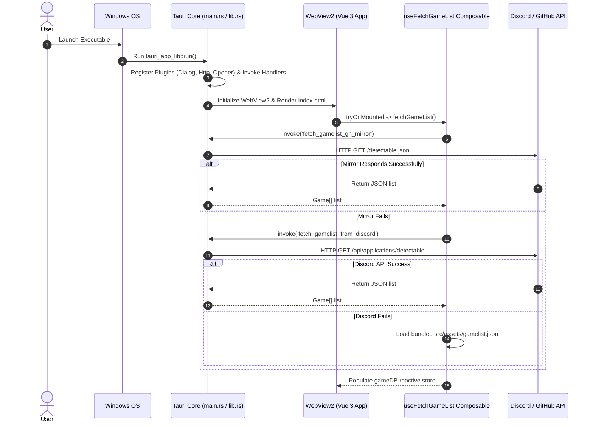
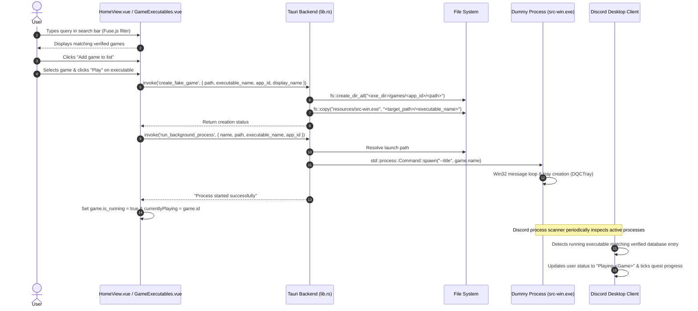
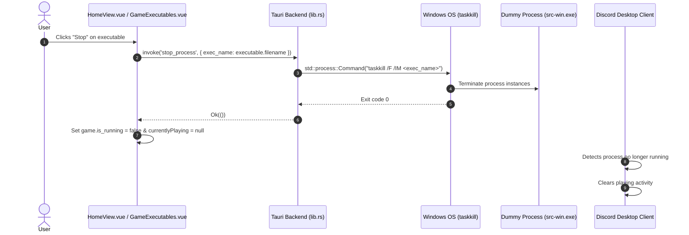
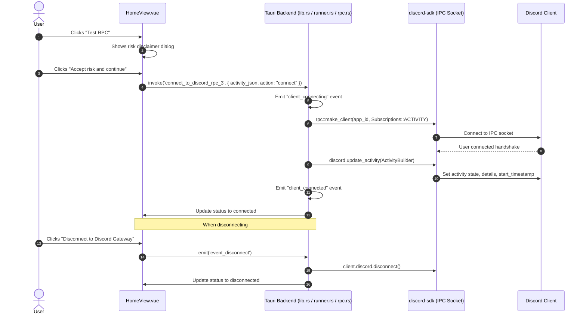

# Execution Flow

## 1. Application Startup Flow

---

## 2. Game Selection and Dummy Process Launch Flow

---

## 3. Game Process Termination Flow

---

## 4. Discord Direct RPC Flow (Experimental Feature)

